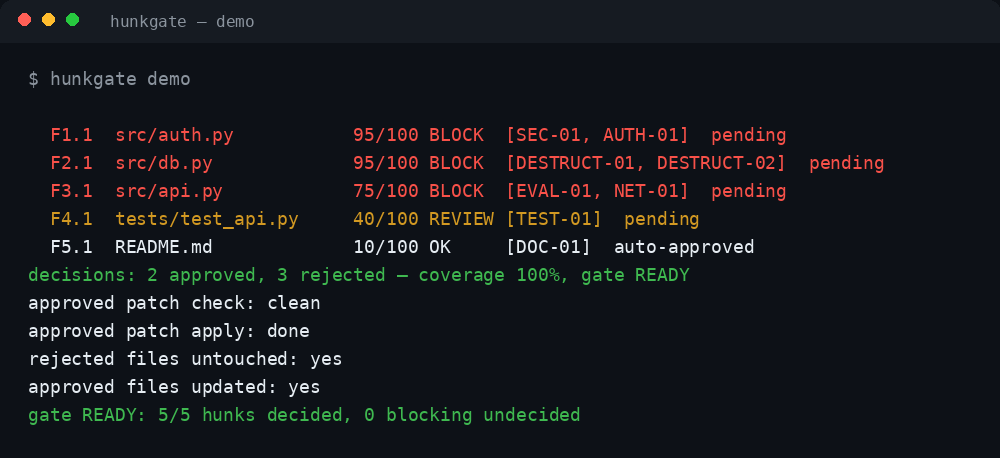

# hunkgate — the human gate for agent-written code

[](https://github.com/BidyutRoy2/hunkgate/actions/workflows/ci.yml)
[](LICENSE)
[](pyproject.toml)
[](pyproject.toml)

**Your agent says "done". hunkgate is the five minutes between that claim and the merge.**

Capture the diff, see every hunk risk-scored, approve what you trust, apply only that, and send the rest back to the agent as a structured prompt. No server, no browser, no model, no network — a zero-dependency Python CLI that keeps everything in `.hunkgate/` inside your repo.



## Why a human gate?

Agents write most of the code now. The review tools we have either review *for* you (LLM reviewers, which hallucinate — see [reviewvet](https://github.com/BidyutRoy2/reviewvet), the sibling tool that audits reviews) or watch the agent *while it works* (hooks, sandboxes). Nobody owned the five minutes *after* the agent finishes and *before* the merge — the moment a human decides, hunk by hunk, what actually lands.

That moment is now the hottest workflow in agent tooling: [plannotator](https://plannotator.ai) hit #1 on GitHub Trending on 15 November 2026 with a browser workspace for exactly this job. hunkgate is the same job as a CLI: no browser, no server, no plugin, works on any diff file — and it *applies* only the hunks you approved.

```bash
hunkgate capture changes.diff --agent claude-code   # risk-score every hunk
hunkgate show HG-20261115-123045-a1b2c3             # findings + evidence
hunkgate reject HG-... F1.1 --reason "Hardcoded key — use an env var"
hunkgate approve HG-... F4.1 --reason "Skip is temporary, tracked in #12"
hunkgate apply HG-...        # approved hunks only; rejected files untouched
hunkgate feedback HG-...     # copy-paste prompt back to the agent
```

## What it does

| Step | Command | What you get |
|---|---|---|
| Capture | `capture` | A review item: the diff split into hunks, each risk-scored 0–100 with named findings, evidence and fix hints |
| Triage | `list` / `show` | The queue, riskiest first; per-hunk findings with the exact line |
| Decide | `approve` / `reject` / `comment` | Per-hunk, per-file or whole-item decisions, recorded by name in an append-only audit log |
| Apply | `apply` | An approved-only patch (headers recomputed), validated with `git apply --check` before anything is written |
| Feed back | `feedback` | A structured prompt for the agent: approved list, rejected hunks with reasons and fixes |
| Prove it | `report` / `ci` | Markdown / JSON / dark-mode HTML reports; `ci` exits 2 until the gate is READY |

## Risk rules (24 built-in, deterministic)

Secrets and API keys, private key material, hardcoded passwords, TLS verification off, auth decorators removed, CORS wide open, weak hashes, `eval`/`exec`, shell execution, unsafe deserialisation, `rm -rf`, `DROP TABLE`, `DELETE` without `WHERE`, force-push, migrations, dependency changes, new network calls, skipped tests, empty `except: pass`, debug mode — plus an item-level check for code changed without tests. Every rule is a plain regex or path check: no model, no network, no guessing. See [docs/rules.md](docs/rules.md) for the full table.

**Scoring:** critical 90, high 70, medium 40, low 10; a hunk's score is the worst finding plus 5 per extra finding, capped at 100. Bands: OK (0–19), REVIEW (20–49), BLOCK (50–100). The demo fixture scores **95/100**: a hardcoded key, `verify=False`, an `rmtree` + `DROP TABLE` helper and an `eval()` filter — 5 hunks, 8 findings, gate READY after 3 rejections and 2 approvals.

## Install

No PyPI package is published yet — install from source:

```bash
git clone https://github.com/BidyutRoy2/hunkgate.git
cd hunkgate
python -m pip install -e .
hunkgate demo
```

Python 3.9+; zero dependencies; works on Linux, macOS and Windows.

## A full review, end to end

```bash
cd your-project
hunkgate init
git diff > /tmp/agent.diff
hunkgate capture /tmp/agent.diff --agent claude-code --title "Add login"

#  F1.1  src/auth.py   95/100 BLOCK  [SEC-01, AUTH-01]
#  F2.1  src/db.py     95/100 BLOCK  [DESTRUCT-01, DESTRUCT-02]
#  F3.1  src/api.py    75/100 BLOCK  [EVAL-01, NET-01]
#  F4.1  tests/test_api.py  40/100 REVIEW  [TEST-01]
#  F5.1  README.md     10/100 OK     [DOC-01]  auto-approved

hunkgate reject HG-... F1.1 --reason "Hardcoded key + verify=False — use env vars"
hunkgate reject HG-... F2.1 --reason "DROP TABLE + rmtree needs a migration plan"
hunkgate reject HG-... F3.1 --reason "eval() on user input — use a parser"
hunkgate approve HG-... F4.1 --reason "Skip is temporary, tracked in #12"
hunkgate apply HG-...       # applies F4.1 + F5.1; auth.py, db.py, api.py untouched
hunkgate feedback HG-...    # paste this back to the agent
```

Two rules keep the gate honest:

1. **Rejecting needs a reason.** The agent cannot fix what it cannot see.
2. **Approving a BLOCK hunk needs a reason.** "I looked at the secret and it is fine" is a claim that belongs on the record.

New and deleted files are always decided as a whole — a partial new file is not a thing. And silence is not approval: a hunk with no decision keeps the gate closed.

## How hunkgate differs

| Tool | What it is | hunkgate |
|---|---|---|
| [plannotator](https://plannotator.ai) | Browser workspace for reviewing agent plans and code | Same job as a CLI — no browser/server/plugin; applies approved hunks |
| [diffgate](https://github.com/srbsa/diffgate) (srbsa) | Guardrail the agent runs on itself via MCP | The reviewer is the human, not the agent |
| [diffgate](https://pypi.org/project/diffgate/) (KozueMitarai) | Diff-only issue reporter / CI gate | Adds the decision workflow: queue, per-hunk decisions, audit log, partial apply, feedback prompt |
| [ReviewGate](https://github.com/dengmengmian/ReviewGate) | Pre-merge filter (block/warn) | The verdict is the human's, not the tool's |
| [human-gate](https://pypi.org/project/human-gate/) | Approves agent *actions* at runtime via a web page | Reviews *diffs* after the work, in the terminal, per hunk |
| [agent-gates](https://www.npmjs.com/package/@cniska/agent-gates) | Git hooks refusing bad commits | The review *before* the commit exists |
| [hunk](https://github.com/modem-dev/hunk) | Terminal diff viewer (TUI) | A gate, not a viewer: scores, decisions, apply, feedback |

Full comparison: [docs/prior-art.md](docs/prior-art.md).

## Configuration

`.hunkgate.toml` (see `examples/hunkgate.toml`):

```toml
reviewer = "ada"
auto_approve = ["docs-only"]   # or ["tests-only"], or both

[rules.SEC-05]
enabled = false

[[custom_rule]]
id = "ACME-01"
severity = "high"
pattern = "TODO\\(acme\\)"
message = "ACME TODO left in code"
fix = "Resolve the TODO or file a ticket and link it."
direction = "add"
```

## CI gate

```bash
hunkgate ci HG-...          # exit 0 only when the gate is READY
hunkgate ci HG-... --allow-review   # also pass when only REVIEW/OK hunks are undecided
```

See [docs/ci.md](docs/ci.md) for the GitHub Actions workflow.

## What hunkgate cannot do

- **It cannot see runtime behaviour.** A pattern-clean hunk can still be wrong. The score measures *known risky patterns*, not correctness.
- **It cannot read the code for you.** A hunk that scores 0 still needs a human eye.
- **It cannot enforce honesty.** A human can approve everything with `--reason ok` — the audit log records it, but the tool cannot make the human read.
- **It does not run agent code or sandbox it.** Pair it with a sandbox if you need execution guardrails.

Full list: [docs/limits.md](docs/limits.md).

## FAQ

**Does it replace code review?**
No — it orders the queue so your review time goes to the dangerous hunks first.

**Can the agent approve its own work?**
Only if you hand it the terminal. There is no API, no web page and no agent integration. Keep it that way.

**What if a kept hunk depends on a dropped one?**
`git apply --check` fails and `apply` refuses to write anything. Re-review instead of hand-editing the patch.

**Is my review data sent anywhere?**
Nowhere. Everything lives in `.hunkgate/` on your disk. No account, no telemetry, no network call in the codebase.

More: [docs/faq.md](docs/faq.md).

## Development

```bash
python -m unittest discover -s tests -t .   # 90 tests, zero dependencies
hunkgate demo                                 # pinned fixture: 95/100, READY
```

See [CONTRIBUTING.md](CONTRIBUTING.md). The demo fixture's numbers are pinned in CI — a change that moves them fails loudly.

## License

MIT — see [LICENSE](LICENSE).
